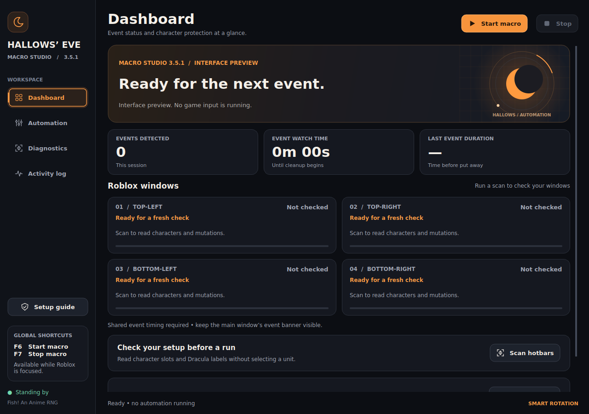

# Computer Vision Desktop Automation

A Windows desktop application that interprets a visual interface and coordinates verified actions across up to four application windows. Built with Python, OpenCV, Tesseract OCR and PySide6, the project combines image processing, concurrent monitoring, Windows input integration and recovery from uncertain observations.

The central engineering challenge is maintaining consistent application state when screenshots are ambiguous, keyboard input arrives late and overlapping windows hide information. The system distinguishes an input request from a visually confirmed result and schedules recovery independently for each window.

**Python · OpenCV · Tesseract OCR · PySide6 · Windows APIs · Multithreading**

## Application Preview



*Version 3.5.1. The screenshot is an interface preview.*

## Project Context

The application was developed for Fish! An Anime RNG on Roblox. It detects the Hallows’ Eve event, selects eligible characters, reads Dracula mutation labels and puts characters away when the event ends. This provides a practical environment for working with changing visual layouts, small text, delayed responses and multiple application windows.

The implementation targets this specific interface. Its broader engineering focus is converting uncertain visual observations into controlled, observable desktop actions.

## Engineering Highlights

1. **Computer vision and OCR**

   Locates inventory cards from their visual layout rather than fixed coordinates. Uses OpenCV image processing and colour masks to isolate relevant regions, with Tesseract for text recognition. Frequent event checks use visual matching, while OCR assists with event text, countdowns and mutation labels.

2. **Concurrent monitoring with serialized input**

   Separates event detection, connection monitoring and background mutation scans from the foreground input worker. A bounded worker pool prevents slow OCR from blocking ready windows or accumulating an unlimited queue. Keyboard and mouse actions remain serialized so workers do not compete for focus.

3. **Confirmed actions and event priority**

   Tracks intended slots, accepted inputs, pending actions and visual confirmations. Two fresh matching observations are required to confirm equipment state. Event end interrupts lower priority work, and stale scan results cannot authorize actions for a completed event. Retry guards reduce the risk of reversing an action when its original input is delayed.

4. **Recovery across multiple windows**

   Maintains stable window identities when a client disconnects. Checks window geometry and visibility before using captured pixels, rejects changed inventory plans and treats hidden interfaces as uncertainty. Healthy windows continue while another window waits for focus, readable evidence or manual fallback.

5. **Responsive interface and bounded resources**

   Provides a native Qt dashboard with per window status, grouped settings, live capture previews and searchable logs. UI messages are bounded and repeated state updates are coalesced. Settings are validated and saved atomically. Optional webhook notifications use a separate bounded delivery queue.

6. **Independent maintenance scheduling**

   Uses monotonic deadlines for anti-idle input so prolonged recovery cannot indefinitely suppress it. Each window receives a short foreground Space press when due, with urgent equipment actions serviced first. Failed input retries independently and remains visible in the activity log.

## Architecture

The main application coordinates several responsibilities through explicit state and bounded work queues:

1. **Capture and recognition:** Read narrow screen regions, identify events and inventory cards, and classify the current selection.
2. **Background observers:** Monitor event transitions and connection health; read mutation labels from copied captures.
3. **Action scheduler:** Prioritize event cleanup, service pending equipment actions and schedule maintenance for each window.
4. **Input worker:** Verify foreground ownership, send input, attempt key release reliably and confirm the resulting visual state.
5. **Presentation and diagnostics:** Display current status, retain rotating logs and export relevant evidence for debugging.

`hallows_eve_macro.py` contains the application, vision and automation logic. `macro_runtime.py` isolates the platform independent mailbox, bounded executor and settings utilities.

## Validation and Measured Results

The packaged version 3.5.1 passed **12 of 12 regression suites**. Tests combine supplied image fixtures, Tesseract checks, real offscreen Qt widgets and simulated Windows input. The recorded results are available in [VALIDATION_3_5_1.log](VALIDATION_3_5_1.log).

Coverage includes delayed and dropped inputs, focus refusal, overlapping windows, hidden inventory bars, changed layouts, stale OCR results, disconnected clients, event interruptions and prevention of duplicate toggles. Interface checks cover navigation, settings persistence, log handling and smaller window sizes.

A scheduler regression runs three separate **30 minute simulations** covering prolonged cleanup, event end waiting and continuously active events. Each scenario verifies that all four windows receive scheduled anti-idle input while urgent equipment actions run first.

In a replay with a **130 ms simulated game response**, all four overlapping windows confirmed equipment selection in **1.12 seconds** and cleanup in **1.20 seconds**, with one visit to each window. These are simulated input timings, not live Roblox measurements. The [performance report](PERFORMANCE_3_5.log) separately documents image processing benchmarks and the cost of additional inventory validation.

## Run Locally

Requires Windows and Python with the Python launcher and Tcl/Tk.

1. Clone or download the repository, keeping the `tests` and `docs` folders intact.
2. Open the folder containing `hallows_eve_macro.py` and run `RUN_MACRO.cmd`.
3. Complete the setup checks. Missing Python dependencies install into a private environment. Tesseract is detected automatically or installation is attempted through Windows Package Manager; setup also supports manual path selection.
4. Arrange the game windows, review Automation settings and keep the main event banner visible.
5. Start with **F6** and stop with **F7**, or use the interface controls. Both hotkeys are configurable.

Initial dependency downloads require internet access. Windows may request installation approval. The title should display **Macro Studio 3.5.1**.

## Tests and Packaging

Run `RUN_TESTS.cmd`, or use the following command after dependency setup:

```text
python run_tests.py
```

The regression runner does not send live game input. In contrast, application diagnostics marked **SENDS INPUT** interact with the game. The standalone **Anti-idle** diagnostic can be used to check whether each window responds to Space.

Run `BUILD_WINDOWS.cmd` on Windows to build a distributable application with PyInstaller. Share the complete generated ZIP from `dist`. Rebuild existing executables after source changes.

Runtime logs are accessible through **Activity log → Open saved log** and stored under `%LOCALAPPDATA%\HallowsEveMacro\logs`. Personal settings and webhook credentials should not be committed to the repository.

## Scope and Limitations

The application depends on visible game content and a supported interface layout. All tracked windows must share the same event timing because one main banner controls the session. Visual confirmation establishes local interface state, not server acceptance.

Simulated regression results do not establish live Windows input reliability, server idle prevention or unattended overnight outcomes. These require validation on the target computer. The project does not claim universal automation, guaranteed response times or perfect recognition.

## Further Documentation

1. [Engineering audit and architecture decisions](AUDIT_3_5.md)
2. [Anti-idle scheduling correction and verification](ANTI_IDLE_FIX_3_5_1.md)
3. [Performance comparison](PERFORMANCE_3_5.log)
4. [Regression validation results](VALIDATION_3_5_1.log)
5. [Historical release notes](RELEASE_HISTORY.md)
